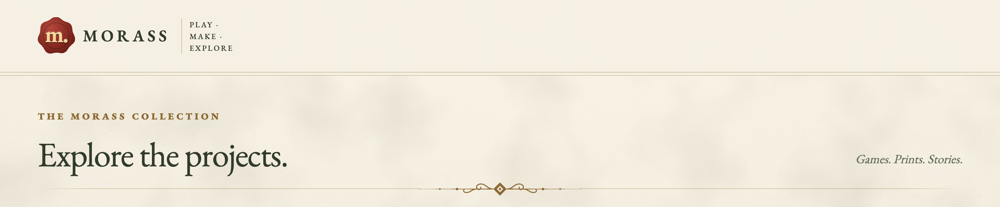
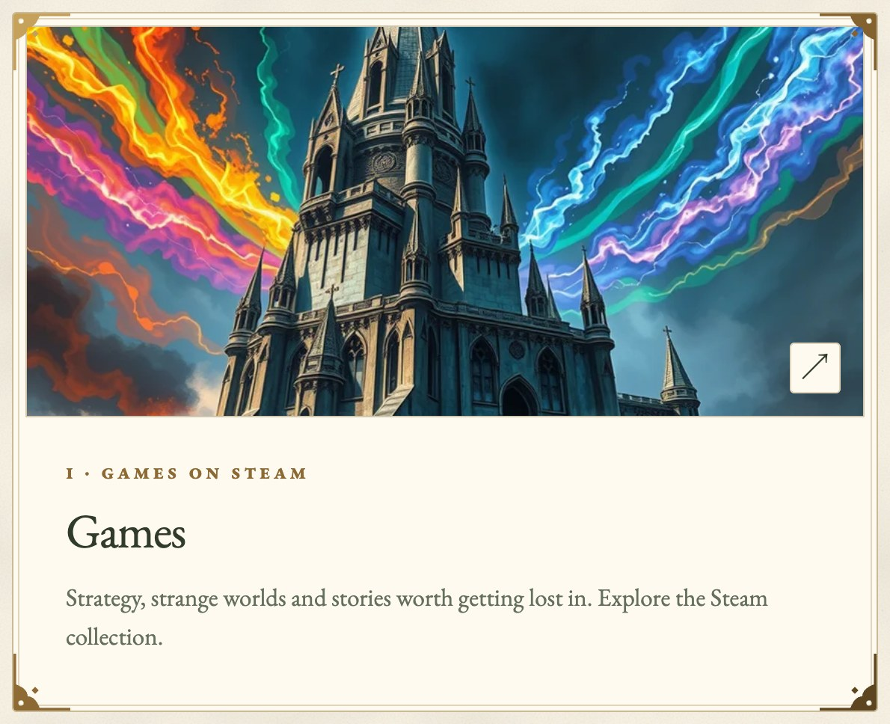
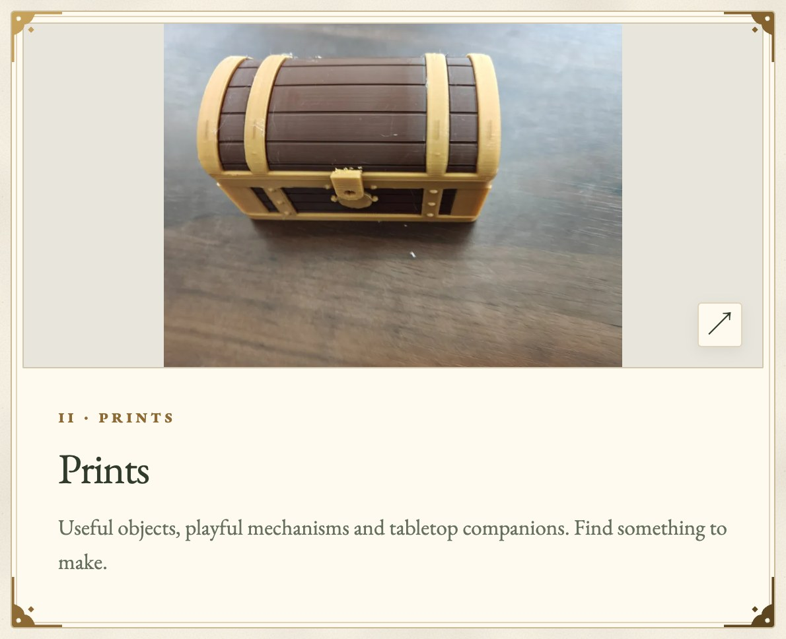
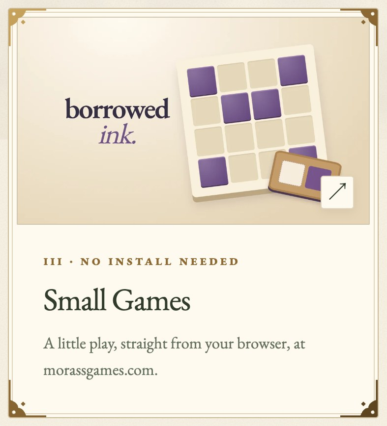
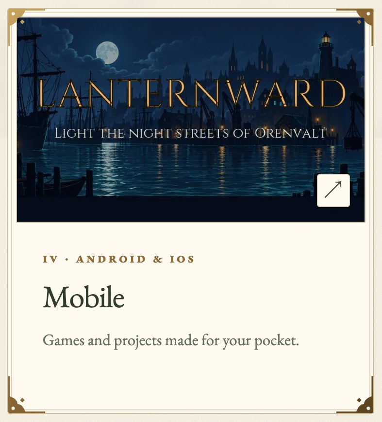
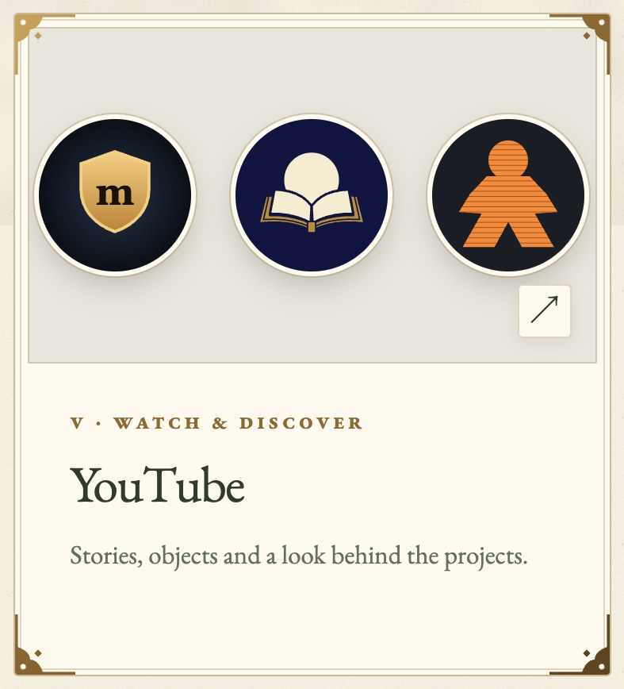
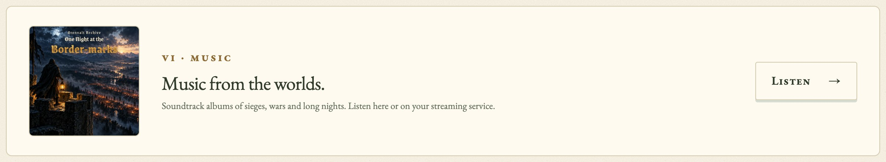
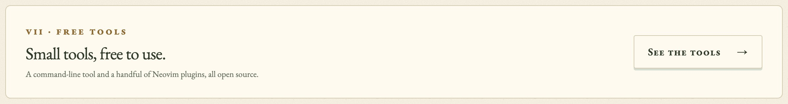

<a href="https://morass.github.io/"><picture><source media="(prefers-color-scheme: dark)" srcset="cards/banner-dark.jpg"></picture></a>

<a href="https://morass.github.io/games/"><picture><source media="(prefers-color-scheme: dark)" srcset="cards/games-dark.jpg"></picture></a>
<a href="https://morass.github.io/prints/"><picture><source media="(prefers-color-scheme: dark)" srcset="cards/prints-dark.jpg"></picture></a>

<a href="https://morass.github.io/small-games/"><picture><source media="(prefers-color-scheme: dark)" srcset="cards/small-games-dark.jpg"></picture></a>
<a href="https://morass.github.io/mobile/"><picture><source media="(prefers-color-scheme: dark)" srcset="cards/mobile-dark.jpg"></picture></a>
<a href="https://morass.github.io/youtube/"><picture><source media="(prefers-color-scheme: dark)" srcset="cards/youtube-dark.jpg"></picture></a>

<a href="https://morass.github.io/music/"><picture><source media="(prefers-color-scheme: dark)" srcset="cards/music-dark.jpg"></picture></a>

<a href="https://morass.github.io/tools/"><picture><source media="(prefers-color-scheme: dark)" srcset="cards/tools-dark.jpg"></picture></a>

